# docker-protheus-2610
Protheus 12.1.2610 em containers Docker (Postgres, DBAccess, License Server 3.7.2, AppServer 26.3, SmartView 3.11).

> Em preparação: as imagens `emebatista/*-2610` ainda não foram publicadas no Docker Hub. Enquanto isso, use o repositório da versão anterior: https://github.com/emebatista/docker-protheus-2510

<h2>Protheus 12.1.2610  - Postgres </h2>

Procedimentos:
1. Instalar o <b>Docker</b> ( https://www.docker.com/products/docker-desktop/ ). <b>IMPORTANTE:</b> Se você possui um Mac com chip M1/M2, desabilite no Docker a opção "Use Rosetta for x86_64/amd64 emulation on Apple Silicon", caso contrário os conteiners podem não subir. 
2. Criar uma pasta e copiar os arquivos <b>docker-compose.yml</b> ( https://github.com/emebatista/docker-protheus-2610/blob/main/docker-compose.yml )  e <b>conf.inf</b> ( https://github.com/emebatista/docker-protheus-2610/blob/main/conf.inf )
3. Abrir o terminal dentro da pasta criada e que contém os dois arquivos anteriores e dar os comandos: <br>
```docker login``` <br>
e depois <br>
```docker-compose up -d ``` <br> Se as imagens já estiverem em cache e quiser forçar baixá-las de novo, o comando é <br> ```docker-compose up -d --pull```<br>
No Docker Desktop, o nome do grupo de conteiners será o mesmo do nome da pasta onde foi dado o comando.
4. Acessar o <b>Protheus</b> através do smartclient através na porta <b>1234</b>. O nome do ambiente é <b>P2610</b>. Após subida dos containeres, aguarde 5 minutos até entrar pela primeira vez no sistema, pois logo na primeira construção do container o banco de dados será criado e restaurado o backup inicial. 
5. Acessar o <b>Protheus WebApp</b> através do navegador do endereço <b>http://localhost:4321</b>.
6. Usuário: Admin , senha: ```T0tvs@2026``` (senha da release 2610; na 2510 era ```$$T0tvs$$```)
7. Primeiro entre em SIGACFG / Cadastros / Configuração do Tipo de Ambiente -> Definir como "Desenvolvimento"
8. O SmartView já vem instalado e pré-configurado em uma máquina virtual chamada smartview-2610 com as portas 7017 e 7019 expostas:
    - Para verificar o status do serviço do SmartView: http://localhost:7019/diagnostic
    - Para alterar configuração do SmartView, criação de conectores, consultas específicas e relatórios, o endereço é http://localhost:7017/
    - Para reconfigurar o SmartView: http://localhost:7019/startup
    - Dentro do Protheus, para poder acessar os relatórios no novo formato, é preciso acessar SIGACFG / Ambiente / Cadastros / Configuração SmartView. Depois escolher a opção "token protheus". É IMPORTANTE informar na url o IP real da máquina (não localhost nem 127.0.0.1), informe no formato http://ip:7017 e clicar 'Testar Conexão'. Exemplo: http://192.168.0.10:7017.
    
    Para todas as configurações de IP no smartview, informe o IP do computador onde ele estará instalado:

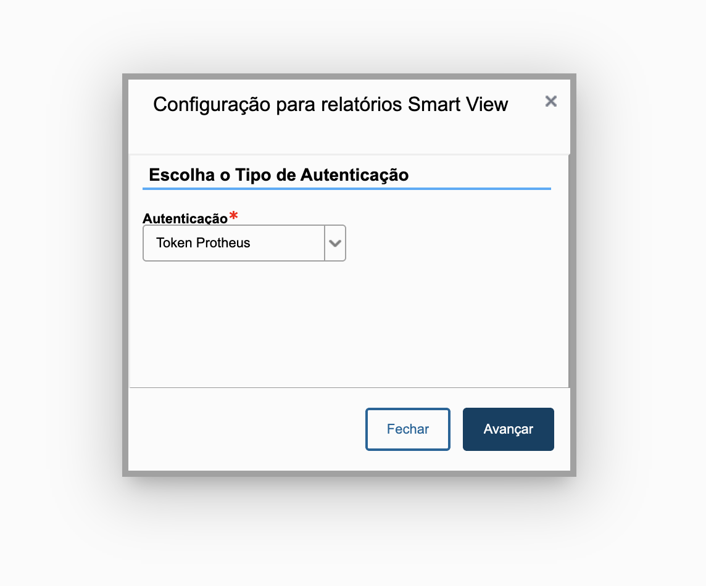    

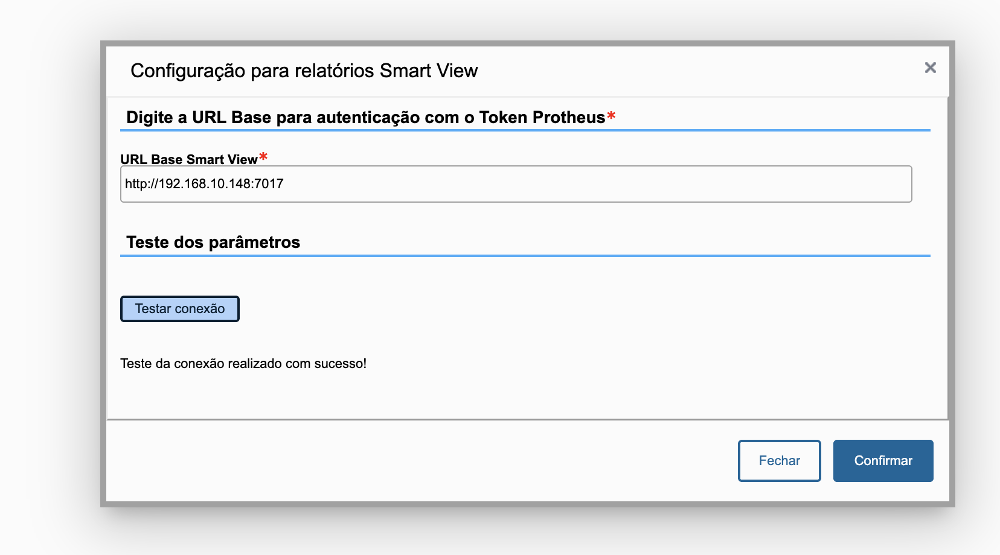

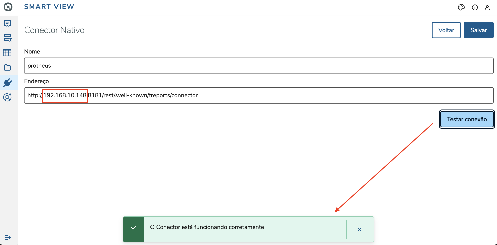
    
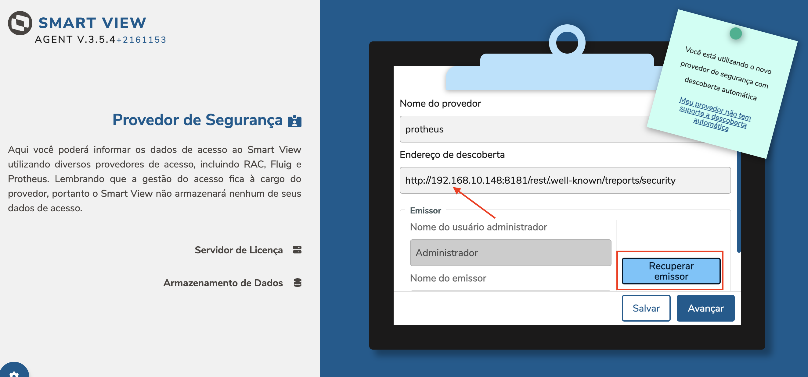

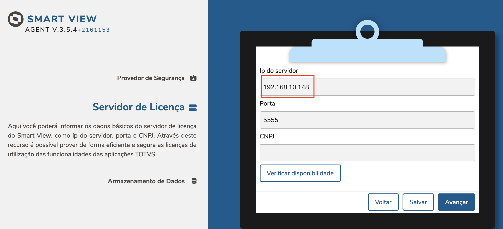

    - Para acessar o WebMonitor: http://localhost:1234/webmonitor
    - DeskFlow Control (gerenciamento dos containers, quando incluído no compose): http://localhost:8073 , usuário ```admin``` , senha ```msadm```
    
Notas:
1) Para utilizar o Protheus na interface sem a porta multiprotocolo, utilize o ambiente P2610D. Esta opção é útil quando se precisa compilar customizações desenvolvidas em ADVPL/TLPP.
2) Para apagar todas as imagens, volumes e containers que não estão rodando, o comando para apagar tudo e manter apenas os volumes do banco de dados e a pasta system_temp, o comando é :<br> ```docker system prune --all --volumes --force``` 
3) Para atualizar e baixar novamente apenas um dos containers, use os comandos<br>
```docker-compose up -d --no-deps --force-recreate license```<br>
```docker-compose up -d --no-deps --force-recreate protheus```<br>
```docker-compose up -d --no-deps --force-recreate db```<br>
```docker-compose up -d --no-deps --force-recreate smartview```<br>
```docker-compose up -d --no-deps --force-recreate dbaccess```<br>
4) Se já possuir conteiners com a versão 2410 ou 2510, é preciso que estas vm estejam paradas para que as da versão 2610 possam subir, uma vez que usam as mesmas portas.
5) Existe um conteiner para acesso exclusivo (protheus-2610-exclusivo), que não sobe serviços de Rest e permite alterar a base em modo exclusivo.
Acesse a porta 4322 para o appserver de modo excluisivo. Antes, porém, pare a execução da vm 'protheus'.

---

<h2>Gerencie o Protheus com o DeskFlow Control</h2>

Este projeto vem preparado para ser operado pelo **DeskFlow Control**, uma ferramenta de gestão de ambientes Protheus/AppServer que roda no próprio servidor (Linux ou Windows) e controla serviços, ambientes, INIs, RPOs, patches e dicionários por uma interface web. Aqui ele roda como mais um container e enxerga o Protheus, o DBAccess, o License Server e o SmartView como serviços.

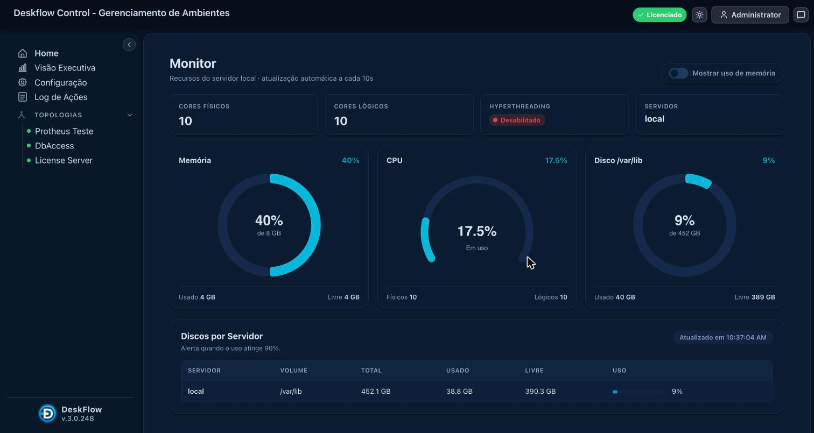

<h3>Por que usar o DeskFlow no dia a dia</h3>

- **Um painel para tudo**: iniciar, parar e reiniciar cada serviço (ou todos de uma vez) com status em tempo real, portas em uso e consumo de memória. Chega de `docker compose stop/start` na mão.
- **Modo exclusivo com um clique**: para os serviços normais e sobe o `protheus-2610-exclusivo` (sem REST) para manutenções que exigem acesso exclusivo à base; desativa e tudo volta ao normal.
- **Ambientes e RPO sob controle**: promover RPO entre ambientes com histórico e rollback, comparar ambientes, gerar hash do RPO, aplicar patches (PTM/PAK/UPD) com defrag opcional e compilar fontes ADVPL/TLPP.
- **Atualização de dicionário**: upload dos arquivos de dicionário, backup automático do `systemload`, execução do UPDDISTR e restauração.
- **INIs sem medo**: edição dos `appserver.ini` com validação, comparação de seções, detecção de chaves duplicadas e conversão de encoding.
- **Auditoria da topologia**: checagens automáticas (INIs legíveis, ambiente principal único, sourcepaths válidos, ordem de start/stop, compilador configurado…) com semáforo verde/amarelo/vermelho.
- **Visão executiva**: saúde geral de todas as topologias, serviços operacionais, riscos de auditoria e atividade operacional do período.
- **Logs ao vivo**: `console.log` do AppServer e `dbaccess.log` direto na tela, com filtro por palavra-chave e download.
- **Agendador**: tarefas recorrentes (restart de serviços, promoções, patches) por cron ou intervalo.
- **Rastreabilidade**: log de todas as ações com usuário, hora, topologia, serviço e resultado; notificações em tempo real.
- **Usuários e permissões**: grupos, permissões por topologia/serviço/ambiente, integração opcional com Active Directory.
- **Multi-servidor**: controla também serviços remotos (SSH no Linux, SCM/WMI no Windows) a partir de uma única console.

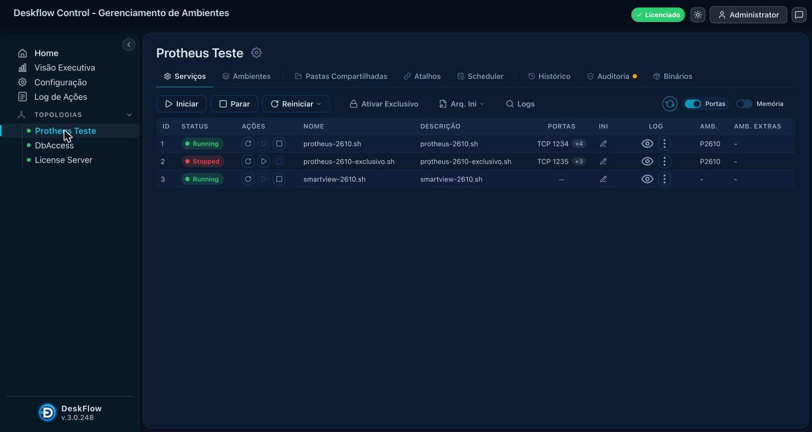

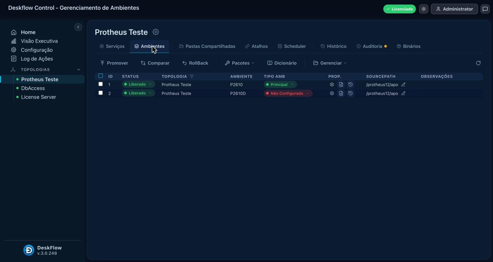

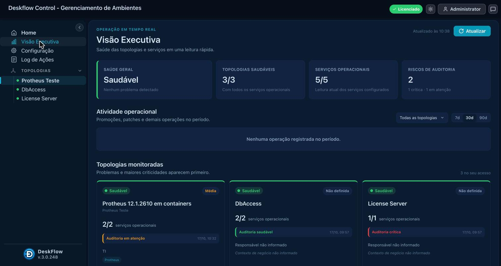

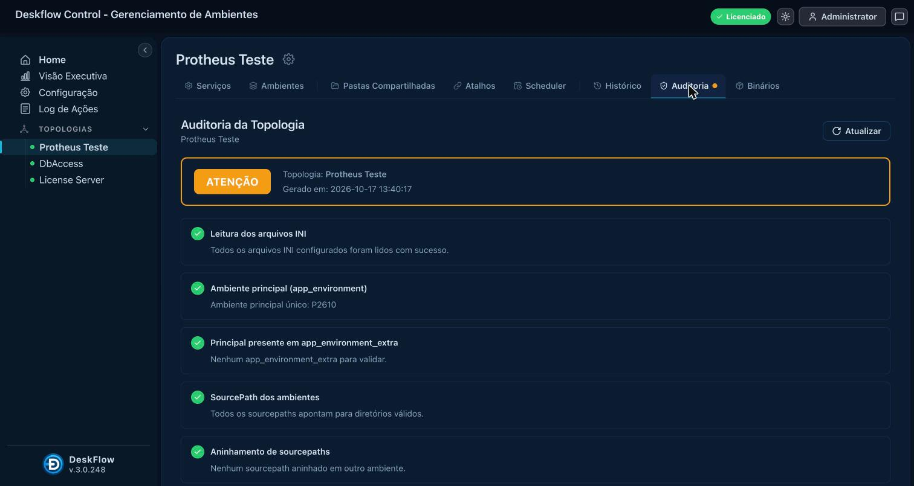

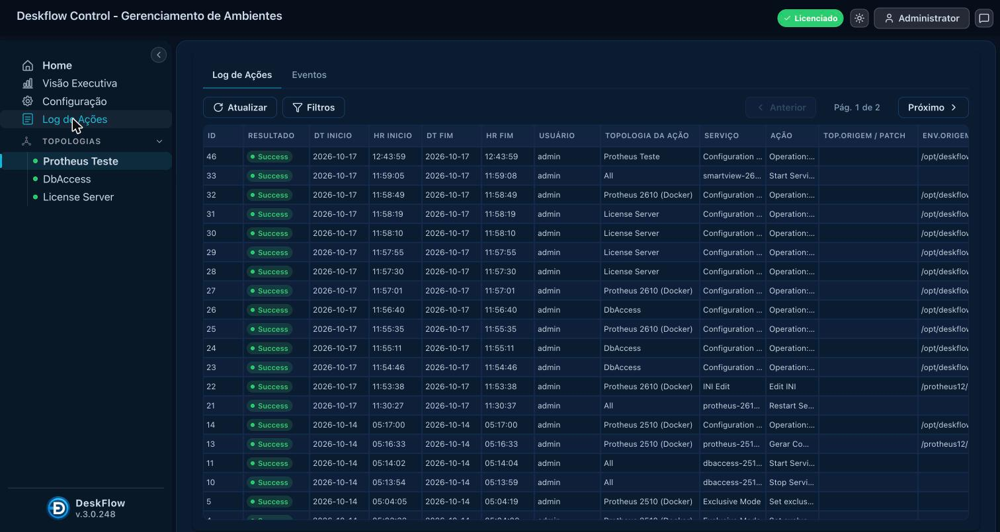

<h3>Como subir o DeskFlow junto com o Protheus</h3>

O DeskFlow precisa enxergar os arquivos do Protheus (INIs, RPO, `console.log`) pelos mesmos caminhos que os containers usam. Por isso a sobreposição `docker-compose.deskflow.yml` monta as pastas `./volume/protheus12` e `./volume/dbaccess` nos containers e no DeskFlow.

1. Copie para a sua pasta, além do `docker-compose.yml` e `conf.inf`, os arquivos `docker-compose.deskflow.yml`, `seed-volumes.sh` e a pasta `deskflow/` deste repositório.
2. Crie as pastas de volume a partir das imagens (uma vez):<br>
```./seed-volumes.sh```
3. Suba tudo:<br>
```docker compose -f docker-compose.yml -f docker-compose.deskflow.yml up -d```
4. Acesse **http://localhost:8073** com usuário ```admin``` e senha ```msadm``` (troque a senha no primeiro acesso). A topologia "Protheus 2610 (Docker)" já vem configurada em `deskflow/config.json` com os seis serviços, os ambientes `P2610`/`P2610D`, os INIs e os logs.

> Imagem `emebatista/deskflow-2610` em preparação, será publicada junto com as demais imagens 2610.

<h3>Licença</h3>

O DeskFlow Control é um produto licenciado por servidor. Esta demonstração em containers mostra o produto completo; para usar no seu ambiente (VM ou servidor físico, Linux ou Windows), solicite uma licença de avaliação ou comercial em **https://deskflow.com.br** (menu Contato) ou pelo e-mail `emebatista@hotmail.com`, informando nome da empresa e quantidade de servidores. A licença é aplicada nos campos `tenant_code`, `tenant_name` e `tenant_authorization` do `deskflow/deskflow.ini`.


ATENÇÃO!
Para que a base contenha dados de exemplo, aguarde até a vm do postgres chegar a este ponto:
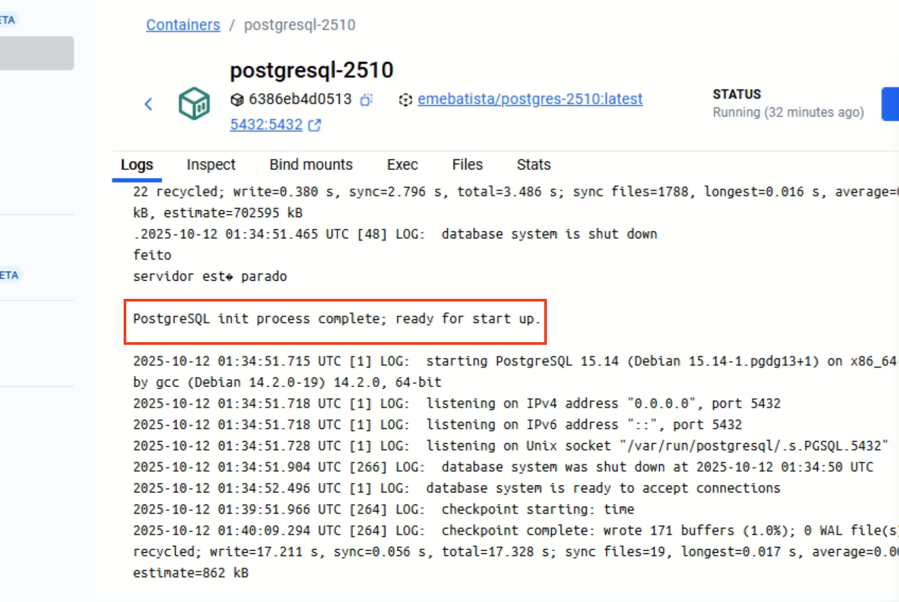

Enquanto estiver em execução, aparecerá algo como:
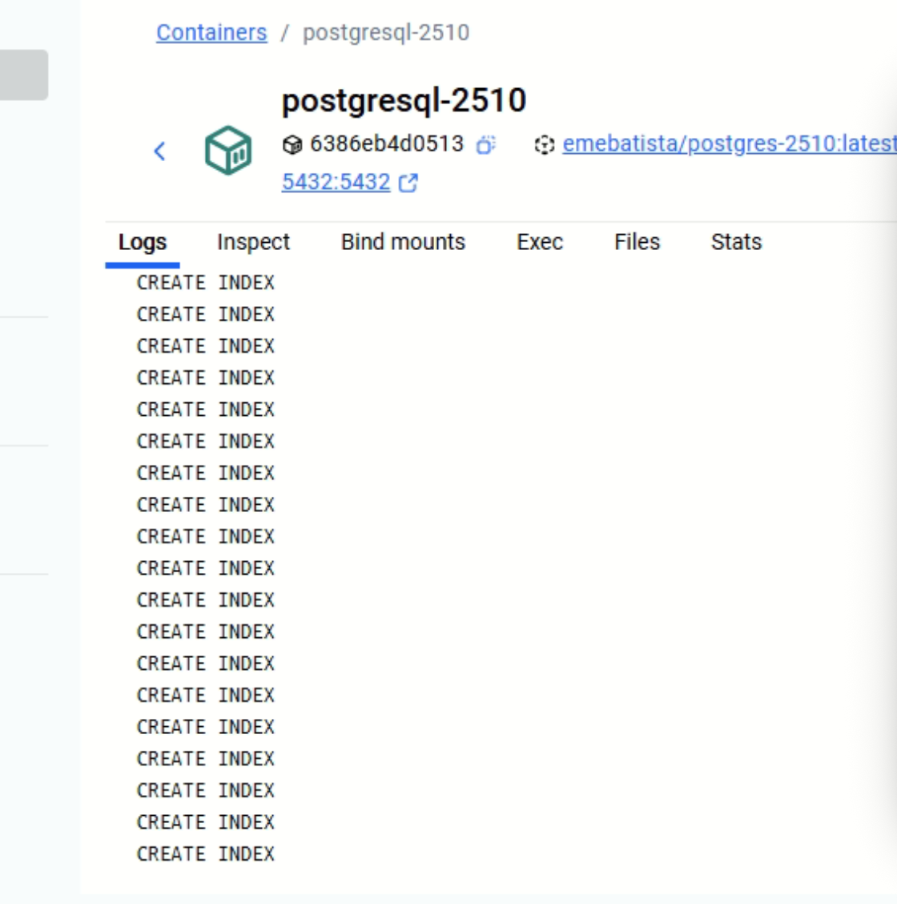

